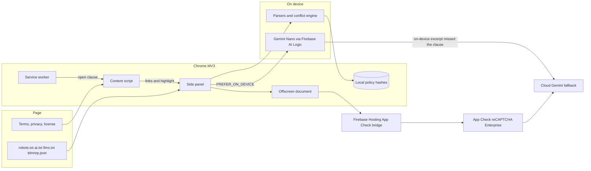

# MayI

**FinePrint.** A Chrome extension that reads a site’s terms, privacy policy, and license, then answers “May I…?” in one sentence with the clause it used.

Machine-readable files already say what a crawler may do. The contract often says something else. MayI puts those two readings on the same card and flags the fight.

This is an entry for Google’s [#BuildHybridAI](https://devpost.com) hackathon. Judging closes Monday, November 30, 2026, 2:00 PM PT. It is a reading aid, not legal advice.

## The problem

[Machine Readiness](https://machinereadiness.com/permission) reports what `robots.txt`, `ai.txt`, and TDM headers allow. [CrawlPact](https://crawlpact.com) audits a site’s declared crawler policy — `robots.txt`, meta robots, `X-Robots-Tag`, `llms.txt`, RSL, Content Signals — against a versioned crawler list. It does not run a model and it does not read the human contract. [ToS;DR](https://tosdr.org) crowdsources consumer-rights grades of terms.

None of them answer a specific question from the sentence the site actually published, then show you that sentence. None of them tell you when the robots file and the contract disagree.

MayI does four things:

1. **Ask.** Preset questions (scrape, train, commercial use, screenshots, cancel anytime, sell my data, forced arbitration, auto-renewal) and anything you type that starts with “May I…?”. Each answer is Yes, No, or Conditional, one plain sentence, and the exact quoted clause. **Show this clause** scrolls the policy page and highlights that span.
2. **Conflict.** `robots.txt`, `ai.txt`, `llms.txt`, TDMRep / `tdm-reservation`, and meta `noai` are merged into a posture. If the files allow AI training and the terms forbid it, that sentence is the headline.
3. **Changes.** Policies are hashed in `chrome.storage.local` (or `localStorage` in the lab). The next time the wording changes, MayI shows the added and removed sentences and names the topic: selling personal information, arbitration, renewal, cancellation, training, scraping, screenshots.
4. **Card.** A per-site permission card, exported as a PNG or as Markdown.

Short policies are handled on the device. A document past Gemini Nano’s excerpt budget is chunked; if the on-device answer cannot be tied to a real quote, MayI retries in the cloud and the badge says **Cloud**. A quote the page does not contain is dropped, and the verdict becomes Unknown.

## Architecture



The conflict report, the diff, and the citation check are deterministic. The model only writes the plain-language sentence. If its quote cannot be found in the page, the quote is not shown.

## How this differs

| | MayI | Machine Readiness | CrawlPact | ToS;DR |
| --- | --- | --- | --- | --- |
| Reads the human terms, privacy policy, and license | Yes, on the page | No. Reports robots.txt, ai.txt, and TDM | No. Audits declared crawler files only | Crowd summaries of terms, not a live read of the page you are on |
| “May I…?” with Yes / No / Conditional and a quoted clause | Yes, and the clause highlights on the page | No | No | Grades and sometimes quotes, not a question you type |
| Files versus contract | Headline when they disagree | Machine signals only | Machine signals only, checked against a crawler registry | Not compared to robots.txt |
| Policy change, in plain English | Local hash and a sentence diff | No | No | No |
| Model | Firebase AI Logic, Gemini Nano first, cloud labeled | None | None. CrawlPact says it does not use a model | None on the page |
| Where the text goes | On-device first. Cloud only for a long document that Nano could not ground | Their service | Their audit | Their database of graded sites |

## Built for #BuildHybridAI

Every model call goes through the Firebase JS SDK:

```ts
import { getAI, getGenerativeModel, GoogleAIBackend, InferenceMode } from "firebase/ai";

const ai = getAI(app, { backend: new GoogleAIBackend() });
const model = getGenerativeModel(ai, {
  mode: InferenceMode.PREFER_ON_DEVICE,
  inCloudParams: { model: "gemini-3.5-flash-lite" },
});
await model.initializeDeviceModel(onProgress); // from a user gesture
const result = await model.generateContent(prompt);
result.response.inferenceSource; // "on_device" or "in_cloud"
```

- Chrome 139+ desktop can run Gemini Nano. `PREFER_ON_DEVICE` uses it when the model is downloaded and falls back to the cloud when it is not.
- On-device context is about 9,216 tokens. MayI sends at most ~6,000 characters of ranked excerpts, and the cloud retry may send about 18,000. Past 12,000 characters, a clause that is missing from the on-device excerpt triggers one cloud retry. The badge on that answer says **Cloud**. Sable Ferry is the sample that shows this: without Firebase keys the card says **Cloud route** and still quotes the real sentence from the full page.
- The displayed quote must be a real span from the page (`locateQuote`). A preset classifier can correct the verdict when it disagrees with the model about that span.
- With no Firebase config, MayI still answers. That path is a local clause matcher. The badge says **Local reading**. It is not Gemini.

### Firebase and App Check

Copy `.env.example` to `.env.local`. Never commit real keys.

| Variable | Where it comes from |
| --- | --- |
| `VITE_FIREBASE_API_KEY`, `AUTH_DOMAIN`, `PROJECT_ID`, `STORAGE_BUCKET`, `MESSAGING_SENDER_ID`, `APP_ID` | Firebase console → Project settings → Your apps → Web |
| `VITE_FIREBASE_APPCHECK_RECAPTCHA_SITE_KEY` | reCAPTCHA Enterprise score key, registered as the App Check provider |
| `VITE_FIREBASE_APPCHECK_DEBUG_TOKEN` | Local only. `true` prints a token, or paste one registered under App Check → Manage debug tokens. Do not ship a build with this set |
| `VITE_APPCHECK_BRIDGE_URL` | `https://YOUR_PROJECT.web.app/app-check.html` after you deploy `hosting/` |
| `VITE_EXTENSION_ID` | The unpacked extension id. The bridge only `postMessage`s tokens to `chrome-extension://` that id |

App Check is initialized with `ReCaptchaEnterpriseProvider` in the lab. Manifest V3 extension pages cannot load `https://www.google.com/recaptcha/enterprise.js`, so the extension uses a different path:

1. Set `self.FIREBASE_APPCHECK_DEBUG_TOKEN` before `initializeAppCheck` for local unpacked builds. The SDK exchanges the debug token and does not load reCAPTCHA.
2. For a build you ship, an offscreen document (`chrome.offscreen`, reason `IFRAME_SCRIPTING`) frames the Hosting page. That page runs the Firebase App Check SDK and reCAPTCHA Enterprise, then posts the App Check token back. The extension installs it with `CustomProvider`. Token lifetime is treated as 55 minutes because the SDK’s token result only returns the token string.

Deploy the bridge from `hosting/` after copying `hosting/public/config.example.js` to `hosting/public/config.js` (gitignored):

```bash
npx firebase-tools deploy --only hosting --project YOUR_PROJECT_ID
```

Turn on App Check enforcement for the Gemini / AI Logic API in the Firebase console or cloud calls are rejected. The extension CSP allows frames on `https://*.web.app` and `https://*.firebaseapp.com`, and connects to `https://*.googleapis.com`.

`initializeDeviceModel` runs on the first question you ask, which is a user gesture, as the on-device API requires.

### Android

Not in this entry. Firebase AI Logic’s `prefer_on_device` mode is the same idea on Android once Gemini Nano is available through AICore. The parsers, conflict rules, and citation check are plain TypeScript and can move over. The Chrome side panel is the surface that ships here.

## Install

Requirements: Node 22+, Chrome 139+ if you want Gemini Nano. The lab runs without Chrome and without Firebase keys.

```bash
npm install
npm test
npm run dev
```

Open [the lab](http://127.0.0.1:44731). `npm install` uses legacy peer deps (see `.npmrc`) because npm 10’s installer crashes on Vitest’s optional peer graph.

Load the extension:

```bash
npm run build
```

Chrome → `chrome://extensions` → Developer mode → Load unpacked → select `dist/`. Pin MayI and click the icon. The side panel opens. On a normal `http` or `https` page, press **This tab**.

Sample pages are also packed inside the extension at `dist/samples/` so the offline corpus ships with the build. The lab is the supported way to click through them, because the dev server adds the TDM and `X-Robots-Tag` headers those fixtures expect.

## Samples

Five fictional sites live in `public/samples/`. The prose is original. It is not copied from anyone’s terms.

| Site | What to look at |
| --- | --- |
| Northwind Archive | `robots.txt` and `ai.txt` allow training and scraping. The terms forbid both. The banner is the conflict. |
| Lumen Health | Files and contract agree: no training, no scraping. The privacy policy now sells location data. **Changes** shows that against the stored previous copy. Arbitration and auto-renewal are in the terms. |
| Kindred Press | `ai.txt` is only at `/.well-known/ai.txt`. Training is conditional on both sides: you may train if you give credit. |
| Pinnacle | A long contract. Scraping is allowed only through the documented API while `ai.txt` denies scraping, so the signals tab shows tension. Cancellation is by certified mail. |
| Sable Ferry | Longer than Gemini Nano’s excerpt. The files allow training. The ban is a single sentence past the on-device window, so the answer card says **Cloud route**. With Firebase configured, that retry is badged Cloud. |

## Tests

```bash
npm test
npm run typecheck
```

`tests/mayi.test.ts` covers the robots parser (including Content-Signal), the ai.txt directive parser, llms.txt opt-out language, TDM reservation merging, clause citation (exact, whitespace-normalized, and fuzzy), chunk selection around a late keyword, the policy diff, and the sample sites: the Northwind conflict, the Kindred well-known path, the Lumen privacy diff, Pinnacle’s tension, and Sable Ferry’s cloud route (the on-device excerpt misses the training ban, the cloud excerpt contains it).

GitHub Actions (`.github/workflows/ci.yml`) runs `npm ci`, the tests, the typecheck, and `npm run build` on Node 22. The build does not need a `.env` file.

## Project layout

| Path | Role |
| --- | --- |
| `src/lib` | Parsers, citation, chunking, conflicts, diffs, Firebase hybrid client |
| `src/panel` | Side panel UI shared by the lab and the extension |
| `src/lab` | Two-pane demo: sample site plus panel |
| `src/content` | Content script. Extracts links and highlights a clause. No Firebase |
| `src/background` | Opens the side panel and navigates to a cited clause |
| `src/offscreen` | Frames the App Check bridge |
| `hosting/` | Firebase Hosting page that runs reCAPTCHA Enterprise |
| `DEMO_SCRIPT.md` | Shot list for the 3-minute video |
| `SUBMISSION.md` | Draft Devpost fields. Not submitted |

## Privacy

Policy text is fetched by the extension under `host_permissions` and stored locally, capped at 150,000 characters. It is sent to a model only when Firebase is configured, and then only as the excerpts for the question you asked. The cloud path is the one that leaves the device, and that answer is badged **Cloud**. There is no account and no analytics in this repo.

## License

Apache License 2.0. Copyright 2026 LevelUpWorldHub. See [LICENSE](LICENSE).
